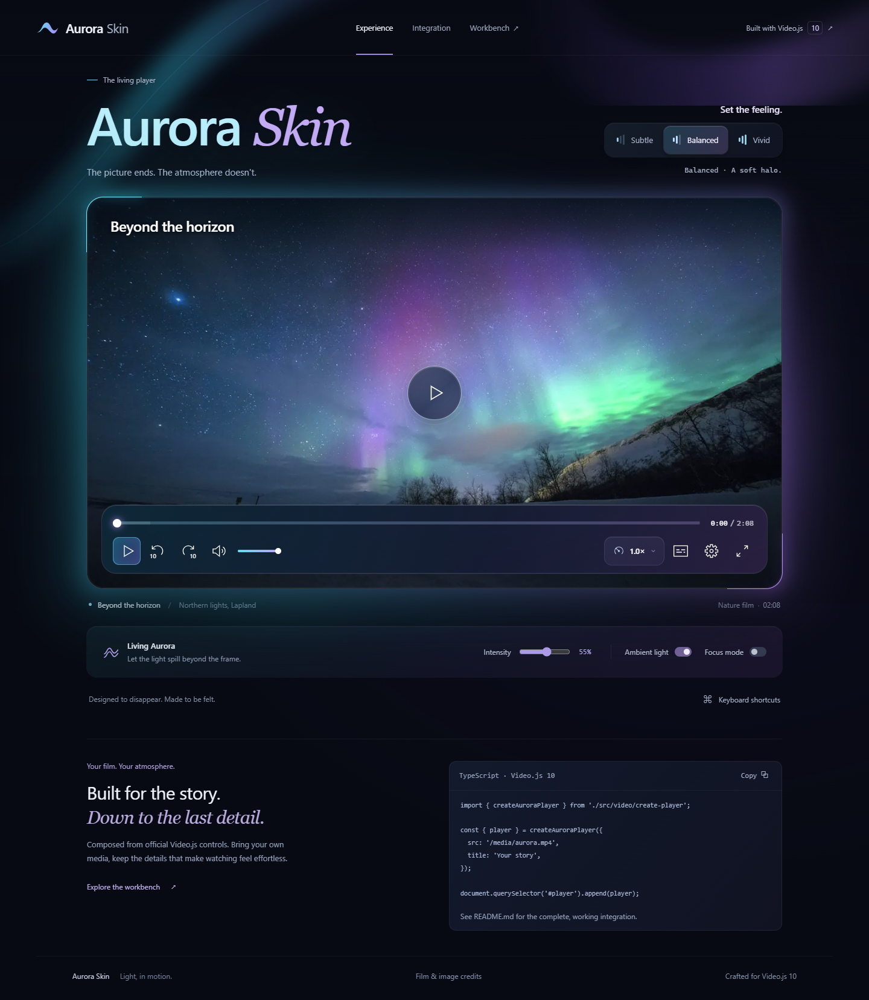

# Aurora Skin

An original cinematic HTML skin for **Video.js 10.3.0**, created with the official `@videojs/cli skin create` generator. Real `video-player` state and official `media-*` components own playback, sliders, menus, captions, fullscreen, gestures, shortcuts and announcements. A native media element is the media adapter inside Video.js, not a standalone player. An optional official PlayerController-based value display keeps speed labels synchronized in both manual composition and the demo.



[Mobile preview](design/implementation/mobile.png) · [Validation](VALIDATION.md) · [Apache 2.0](LICENSE)

## Run

Node.js 24 LTS recommended. Install dependencies with `npm ci`, then run `npm run dev`. Open the URL printed by Vite.

- `/`: the Aurora viewing room, with local sample film and appearance controls.
- `/workbench.html`: the original official workbench, retained for sizes, languages, RTL and playback options.
- `/preview.html`: standalone official preview.
- `/credits.html`: film and poster attribution.

## Integrate into a Vite/TypeScript project

Install `@videojs/html@10.3.0` and copy `src/` into your app. The skin imports no files from the demo. Vite handles the HTML template's `?raw` import.

```ts
import { createAuroraPlayer } from './src/video/create-player';
import { attachLivingAurora } from './src/video/living-aurora';
import './src/video/ambient.css';

const host = document.querySelector<HTMLElement>('#player')!;
host.classList.add('aurora-stage');
const aurora = createAuroraPlayer({
  src: '/media/your-film.mp4',
  poster: '/media/your-poster.jpg',
  title: 'Your story',
  tracks: [{ src: '/captions/en.vtt', language: 'en', label: 'English' }],
});
host.append(aurora.player);
const light = attachLivingAurora(host, aurora.video);
light.setIntensity(55);

// On unmount:
// light.destroy();
// aurora.destroy();
```

Give the mount explicit dimensions (for example `aspect-ratio:16/9`) and set `video-player {display:block;width:100%;height:100%}`. `createAuroraPlayer` generates unique popup/trigger IDs for each instance, uses DOM setters for user-supplied metadata, and exposes cleanup. To compose manually, import `src/video/skin.ts`, paste `skin.html` inside `<video-player>` and replace the media placeholder. Keep `data-theme="scaffold"` and `data-preset="video"`: these select the official foundation CSS. Give every popup/trigger ID a unique prefix when mounting the raw template more than once.

## Visual system

- **Living Aurora:** an 8x4 canvas samples 32 pixels at most twice per second while playing. Spatial left/right colors tint two external glow layers, with exposure lift for dark footage and smooth 800ms color interpolation. Subtle (25%), Balanced (55%) and Vivid (90%) also vary spread. The pointer shifts its origin with at most one animation-frame update pending. Intensity 0 disables sampling and glow. This is frame-color analysis, not audio-reactivity.
- **Adaptive Glass:** sampled lower-frame brightness raises the dock opacity from .86 to .94 over bright footage. The default .90 scrim keeps a dark control surface before sampling, with reduced motion or when sampling is unavailable.
- **Focus:** official Video.js controls hide on inactivity and return on pointer, touch or keyboard focus. The demo Focus mode additionally dims the surrounding page without making it inert or removing focus access.
- **Reduced motion:** disables the breathing animation, pointer motion and recurring color sampling. Controls and a static brand-color glow remain. High contrast/reduced transparency uses an opaque control surface. Forced-colors removes ambient decoration.
- **Performance:** no full-frame readback, canvas animation loop, audio graph or network request for effects. Sampling and animation stop when paused, ended, offscreen, document-hidden or unmounted. Frame reads that throw (such as tainted canvas) fall back safely to the brand palette.

Cross-origin sources and captions must allow CORS because the factory uses `crossorigin="anonymous"`. For a source that intentionally cannot provide CORS, compose a native media element without that attribute; ambient sampling will fall back if the canvas is tainted. That manual external-source configuration has not been tested here.

## Theme tokens

Set on the player/mount:

```css
video-player {
  --media-accent-color: #64e1f8;
  --aurora-violet: #b191fa;
  --media-border-radius: 28px;
  --aurora-radius: 24px;
  --media-font-family: 'Segoe UI', system-ui, sans-serif;
}
```

The player uses system fonts, not a remotely downloaded font. Controls are 46px, with a 0.96 press scale keeping touch targets above 44px; main icons are 24px. Responsive layout uses the player container width, not only the viewport. A ResizeObserver measures the actual dock for caption clearance and hides the duplicate center play button only when the frame cannot fit it. The compact dock keeps play, mute, captions, settings and fullscreen in one row, with speed in Settings and skip actions through gestures/keyboard. This works independently of the demo aspect ratio.

## Keyboard and touch

Focus inside the player. Space/K toggles playback, M mutes, arrows seek/change volume, J/L seek, C toggles captions, F toggles fullscreen, Home/End and digits seek, and >/< change speed. Official sliders and menus support keyboard navigation. Tab reaches controls in source order. Touch taps reveal controls, and double taps on the side regions seek. See `VALIDATION.md` for exactly which interactions were tested; shipped defaults are not all independently validated.

## Media and licensing

The local 2:08 sample is *Aurora borealis timelapse* by Harriniva Hotels&Safaris, CC BY 3.0, transcoded to 1280x720 H.264. It is silent. English and Spanish VTT cues are authored descriptive captions, not a speech transcript. Poster is a separate Unsplash photograph, encoded as 640px (~12 KB) and 1280px (~54 KB) WebP variants with early preload. Media keeps its own license; it is not relicensed Apache 2.0. See `NOTICE` and `/credits.html`.

The source WebM is retained locally in `assets/originals/` and omitted from deployment. It can be downloaded from the original Wikimedia file page linked in NOTICE. Reproduce the MP4 using `ffmpeg -i assets/originals/aurora.webm -vf scale=1280:-2 -c:v libx264 -crf 25 -preset fast -movflags +faststart -an apps/preview/public/media/aurora.mp4` on Windows. The demo loads metadata only until playback; the MP4 is about 16 MB and supports byte ranges when served by Vercel.

Original Aurora source/design is Apache 2.0; the generated Video.js foundation retains its contributor notices. The supplied mockup is retained only as a design reference, not used to fake the player.

## Mux option

Mux is not configured, and no contest bonus is claimed. To use your Mux account: create a public playback asset, install the official adapter, import `@videojs/html/media/mux-video`, replace the video media node with `<mux-video src="https://stream.mux.com/YOUR_PUBLIC_PLAYBACK_ID.m3u8" playsinline crossorigin></mux-video>`, and keep the skin template inside `video-player`. The original generated workbench included this adapter. Revalidate playback, captions, error handling and ambient frame access after integration. Never put a Mux API secret in client code.

## Validate

```sh
npm run typecheck
npm run build
npm test
npm audit --audit-level=high
```

Browser tests use Playwright with installed Google Chrome (`channel: chrome`) and start/reuse Vite at port 5173. Test artifacts are written to `test-results/`. Screenshots are in `design/implementation/`. See `VALIDATION.md` for evidence and limits.

## Vercel

The project is configured for a public Vercel deployment; the current published URL and live verification will be recorded after deployment. Import this directory as the project root. `vercel.json` sets Vite, `npm run build`, and `dist`. `npm ci` uses the lockfile. There are no required environment variables, server functions, account dependencies or runtime secrets for the local-media demo. Build includes the demo, credits, workbench and standalone preview.

To publish yourself, run `npm run deploy vercel`; the host CLI handles sign-in. Recheck real playback, HTTP range responses, fullscreen and captions on the deployed origin. Deployment, Mux upload, contest submission, eligibility, deadlines, judging score and public-project bonus are not established by local tests.

## Source map

- `src/video/skin.html`: official component composition.
- `src/video/skin.ts`: official element/icon registrations.
- `src/video/foundation.css`: generated Scaffold styling (center geometry adjusted).
- `src/video/skin.css`: Aurora tokens, surfaces, timeline, state transitions and responsive controls.
- `src/video/create-player.ts`: optional instance-safe integration helper.
- `src/video/speed-value.ts`: official Video.js PlayerController-based speed readout.
- `src/video/layout.ts`: measured dock geometry and error retry through official player actions.
- `src/video/living-aurora.ts`, `ambient.css`: optional ambient color and light system.
- `apps/preview/demo.*`, `index.html`: viewing-room demo.
- `apps/preview/src/`: preserved official workbench.
- `tests/player.spec.ts`: browser integration tests; `tests/fixtures/contrast.mp4`: generated white/black clip with quiet test tone.
- `DESIGN.md`, `design/spec.md`, `design/fidelity.md`: design decisions and comparison.

Official architecture: https://videojs.org/docs/framework/html/guides/build-your-own-skin
